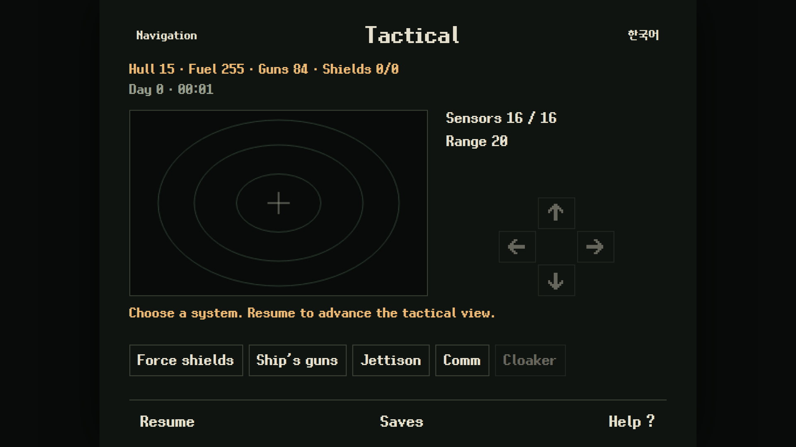
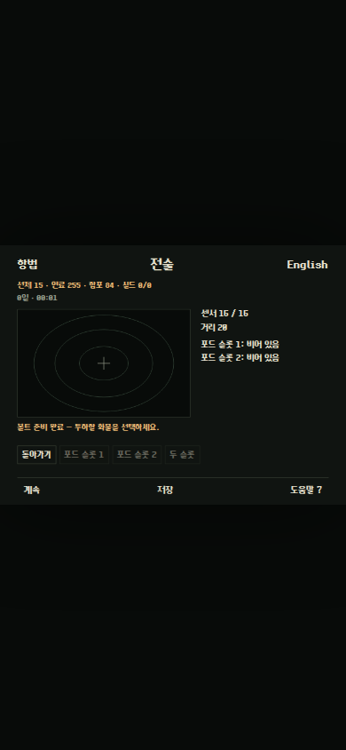

# Live ship encounters and tactical controls

R10r, 2026-10-08. The live asset loader now enables the version29
`ship-salvage-1` campaign host. This connects the source owners documented in
[space host](space-host.md), [ship tactical](ship-tactical.md),
[native input](ship-tactical-input-reference.md), [salvage](ship-salvage.md) and
[recovery](ship-recovery-reference.md). R10 remains in progress under its
[full requirement audit](r10-completion.md).

## Controls and owners

Navigation opens Tactical from pilotage. A successful warp enters the same
controller. Normal entry performs the actual three startup machinery calls;
Comm restoration retains the source return path instead of repeating startup.
Navigation leaves the controller, turns its gun loop off and releases an
outstanding cargo deadline through the existing source reducer.

The root menu exposes Shields, Guns, cargo bolt arming, Comm and Cloaker with
the source sensor/equipment/context gates. Shields adjust the actual target
charge in64-unit steps or to off/full. Guns select laser/cannon, stop the gun
loop, fire or begin eligible tractor collection. The armed cargo submenu shows
actual pod contents and permits only its cached eligible ordinary-cargo slots,
including the source reverse order for Both; cryogens remain excluded. Tractor
collection owns its due machinery calls and blocks incompatible commands while
its saved collection is active.

With the gun loop active, arrow keys and held direction buttons supply signed
source paddle input. Space, primary/right pointer on the tactical canvas and
the Fire button use the same saved native button latch/history. Pointer
position maps to signed -8..8 controls; pointer capture is released on up/cancel.
Holding fire does not create automatic repeated shots after recharge. A short
keyboard activation is latched between source polls and survives a fresh-page
save with its17ms partial budget. Empty-space fire can spend
actual stored energy. Focus loss and pause release physical controls while
preserving source button history and pending short presses.

Every ship host result commits all returned owners: RNG, time, condition,
equipment, engineering failures, fuel/charge/hull, contact/deadline, tactical
state, actual pod manifest, wreck/loss/bounty ledgers and current-system money.
Ground, exchanges, engineering, depot and regional transitions retain the same
space owner. Comm freezes the actual campaign conversation and restores it
through the verified dialogue path after a fresh-page load.

Ship destruction opens a separate Ship destroyed scene without inventing
personal injury. Saved destruction remains terminal. Saved Games can explicitly
restore an earlier campaign; restoration never grants equipment, money or cargo
automatically. Aboard sleep/rest/forced state and its clock remainder can also
be saved and restored.

## Timing and presentation boundaries

The source host owns integer millisecond remainders and50ms tactical frames.
The UI settles elapsed time before input changes, focus release, menu commands,
pause and save; resume anchors the next interval at the actual current time.
Aboard display callbacks commit their consumed timestamp before rerendering,
preventing focus changes from replaying that interval. Ground controls settle
their existing host at the same input/pause/save boundaries; the current
[100 ground checks](r10r-ground-ui-validation.json) include full campaign
equivalence through held arrows, captured pointers, partial saves and fresh
reloads at30/60/144Hz. Deck walking keeps its
separate display interval. Input settling that reaches forced sleep or defeat
renders the terminal/activity scene immediately. Display drawing spends
no RNG and computes no damage.

The canvas contact diamond, range rings, crosshair and wreck square are browser
presentation adaptations, not original sprite/cycle reproduction. Coordinates,
visibility, sensor gates, range and combat outcomes come from the source owners.
English and Korean help describe the controls. All four menus fit the4:3 stage
and every enabled control remains unobstructed at640x480,390x844,844x390 and
1920x1080 in both languages. The cargo-arm warning occupies the status line so
its commands cannot overlap the Saved Games footer.

## Live controlled evidence

[The110-check browser receipt](r10r-space-ui-validation.json) uses Chrome
155.0.8059.39. Its declared imported fixtures provide working equipment, actual
contact and selected RNG/pending-hit contexts. Thereafter all tactical mutations,
shots, due clocks, conversations, collection, losses and recovery use ordinary
UI controls. This is controlled integration evidence, not fresh-character
encounter acceptance.

- Actual entry commits phase3 and gun charge84 from the declared charge100.
- A charge5 keyboard shot leaves target health104; holding through recharge
  produces no second shot. Fresh pointer, right-pointer empty-space, keyboard
  Fire activation and captured directional input use the actual host.
- A source laser kill credits one2000Cr bounty to the current account and
  retains the produced wreck. Actual due calls collect its lot into pod slot2;
  bolt arming and jettison commit its loss, with exact fresh-page continuation.
- Comm and its verified Agree return freeze/reload and arm the real six-call
  cargo deadline. Leaving Tactical restores aggression and releases it.
- A prepared enemy component hit commits engine-unit bytes31/156/30/24,
  performance12, pending engineering offset6 and its combat-failure owner.
- The prepared fatal due frame retains the native phase3/gun60/cooldown35
  vector and personal condition237/235/255/228. Reload freezes the terminal
  clock; loading the earlier saved slot restores every owner and playable time.
- Browser display-callback shims at30/60/144Hz preserve the full campaign state
  across held input/save, a137ms partial budget (remainder37), pause, short fire,
  fresh-page reload, continued tactical frames and sleep/rest continuation.
  The same shims match the independent six-draw component-hit RNG vector, its
  further live continuation, and the five-draw fatal/native-exit vector.

Reproduce with
`python3 tools/remake/browser_check.py tools/remake/space_ui_smoke.js --output <receipt>`.
The shims change only browser display callbacks; no game reducer or state owner
is replaced. Layout checks dispatch a resize event after changing the emulated
viewport while the browser clock is frozen.

Native full tractor collection, fatal startup/Comm-dispatch contexts, rare
kind18 reward target224 and ordinary fresh-character encounter, equipment,
negotiation and defeat/recovery acceptance remain required R10 work.

## Earlier-milestone ordinary regression

[The current81-check ground journey](r10r-r08-journey-validation.json) starts a
fresh seed12345 character and preserves actual engineering replacement, source
service payments, two purchased cargo lots, independent surface parking, foot
ship return/retrieval, another-city visit and loaded docking/reload. Route
planning reads source geometry; straight pod segments use ordinary held input
(one initial pixel followed by two per iteration), with collision-slide segments
kept separate. Four existing food rations are transferred from ship stores;
two are consumed and two actual forced-rest recoveries occur during the trip.
No food, condition, money, equipment, cargo or destination state is granted.
This earlier transport regression does not replace ordinary R10 encounter
fight/lose acceptance. Ground avoidance is separately proven by the
[68-check ordinary exchange journey](r10r-exchange-trading-validation.json).

## Checkpoint receipt inventory

[The checkpoint summary](r10r-validation-summary.json) inventories23 passing
receipts:503 rule groups and1183 UI checks across22 runs, with no failures or
page errors. The UI total includes the controlled110 space and100 ground
checks, ordinary81-check ground journey and64-check two-system flight/trading
journey, navigation44, and17 machinery/engineering/service/interior regressions
with784 checks. Embedded rule arrays are not counted again. Static verification
passes22 exporter tests,171 deterministic artifacts,584 classified source-string
records and all three original-input hashes. Legacy fixtures omit fields absent
from their historical format; newly introduced space ownership matches the
observed fresh-game baseline while prior cargo, money, market, personal and RNG
fields remain exact.

These are checkpoint results. R10 remains in progress under the original
requirement audit.
